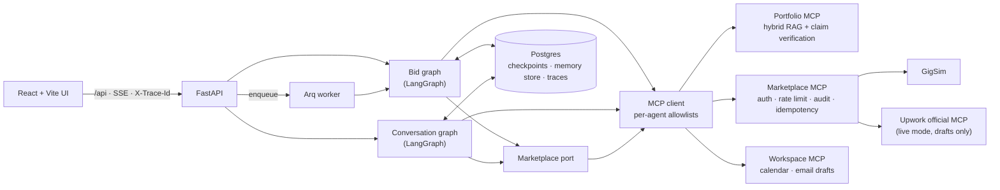
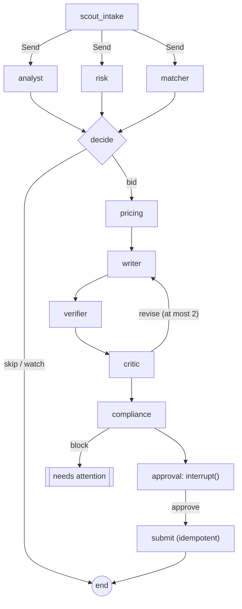

# GigBid

**A bidding co-pilot for freelancers.** GigBid reads the job feed, skips scams and off-profile
work, and drafts proposals in which every claim is backed by the freelancer's own portfolio. A
human approves every send.

<!-- DEMO_GIF: replace with docs/images/demo.gif (30 seconds: inbox -> evidence-backed draft -> approve -> client reply) -->


| | |
|---|---|
| **Live app** | <!-- LIVE_URL -->[https://gigbid-gamma.vercel.app](https://gigbid-gamma.vercel.app)<!-- /LIVE_URL --> |
| **Reviewer login** | `reviewer@gigbid.app` (password supplied with the submission, persona: AI/ML engineer) |
| **3-minute video** | <!-- VIDEO_URL -->_to be added_<!-- /VIDEO_URL --> |
| **Write-up** | <!-- WRITEUP_URL -->_to be added_<!-- /WRITEUP_URL --> |
| **Portfolio MCP server** | [`mcp_servers/portfolio`](mcp_servers/portfolio/README.md), installable with `uvx` |

## What it does

1. **Scouts** saved searches on a schedule, through the official marketplace MCP server or the GigSim simulator. It never scrapes.
2. **Analyses each job in parallel**: requirements (Job Analyst), scams and injected instructions (Risk Assessor), and portfolio evidence for every requirement (Fit Matcher).
3. **Decides** skip, watch or bid, and explains why.
4. **Drafts** a priced proposal, verifies every claim against retrieved evidence, then has it critiqued (at most two rounds) and compliance-checked against the platform policy pack.
5. **Stops for approval.** You see the draft, the evidence behind each claim on hover, the risk report, the price rationale and a dry-run of what will be sent and what it will cost. You can approve, edit or reject.
6. **Handles client replies**: classifies intent, drafts answers, offers interview slots from your calendar, and asks for approval again before anything is sent.

## Architecture





Details, including the conversation graph, the MCP surface, the stores and why each agent exists, are in [docs/ARCHITECTURE.md](docs/ARCHITECTURE.md). Decision records are in [docs/adr/](docs/adr/).

## Results

Every number below is written by `evals/runners/make_results_table.py` from the files in
[`evals/results/`](evals/results/). CI fails if a table is edited by hand
(`scripts/check_readme_numbers.py`).

### RAG variants (B5)
<!-- RESULTS:RAG -->
<!-- written by scripts/fill_readme.py from evals/results/rag_results.json, decision_eval.json -->

Retrieval: macro-average over 3 personas, n = {'aiml': 60, 'fullstack': 60, 'data': 60} dev jobs per persona. Proposal columns: Groq `gpt-oss-20b` profile (`groq_small`), n = 40 dev jobs.

| Variant | Evidence Recall@5 | MRR | nDCG@10 | retrieval p95 (ms) |
|---|---|---|---|---|
| `v0` | 0.012 | 0.034 | 0.025 | 623 |
| `v1` | 0.201 | 0.483 | 0.307 | 3730 |
| `v2` | 0.001 | 0.010 | 0.012 | 782 |
| `v0+ev` | 0.522 | 0.947 | 0.664 | 996 |
| `ev` | 0.547 | 0.909 | 0.699 | 1207 |
| `ev+v1` | 0.547 | 0.892 | 0.706 | 4475 |
| `ev+v2` | 0.594 | 0.935 | 0.756 | 1553 |
| `ev+v3` | 0.524 | 0.926 | 0.715 | 11062 |
| `ev+v4` | 0.514 | 0.792 | 0.650 | 279 |
| `ev+v5` | 0.564 | 0.967 | 0.732 | 266 |
| `ev+v8` | 0.449 | 0.812 | 0.564 | 8404 |
| `ev+v1+v2` | 0.582 | 0.924 | 0.738 | 2608 |
| `ev+v2+v4` | 0.570 | 0.819 | 0.693 | 509 |
| `ev+v2+v5` **(shipped)** | 0.605 | 0.977 | 0.777 | 587 |
| `ev+v2+v3` | 0.522 | 0.925 | 0.725 | 6036 |
| `ev+v2+v5+v8` | 0.509 | 0.895 | 0.640 | 9085 |

| Shipped pipeline, end to end | Unsupported claims per proposal (before → after verification) | GigSim reply rate | p95 latency per job (s) | Cost per job (USD) |
|---|---|---|---|---|
| `ev+v2+v5` + Groq gpt-oss-20b | 1.00 → 0.00 | 0.36 | 60.5 | 0.000561 |

Full tables (per persona, per job type, ablation): [evals/results/rag_table.md](evals/results/rag_table.md). Decision on what ships: [evals/results/rag_decision.md](evals/results/rag_decision.md).
<!-- /RESULTS:RAG -->

Shipped variant and why: [evals/results/rag_decision.md](evals/results/rag_decision.md).

### Decisions and safety
<!-- RESULTS:DECISIONS -->
<!-- written by scripts/fill_readme.py from evals/results/decision_eval.json -->

| Profile | n jobs | Bid/skip macro-F1 | Scam P / R | Price in fair band | p50 / p95 latency (s) | Tokens per job | USD per job |
|---|---|---|---|---|---|---|---|
| Rule-based fallback (no LLM) | 600 | 0.975 | 1.00 / 1.00 | 0.83 | 0.9 / 3.5 | 0 | 0.000000 |
| Open A: gpt-oss-20b (Groq) | 40 | 0.973 | 1.00 / 1.00 | 0.71 | 10.2 / 60.5 | 2781 | 0.000561 |
| Open B: 20b + 120b writer/critic (Groq) | 40 | 0.973 | 1.00 / 1.00 | 0.71 | 19.7 / 142.7 | 3340 | 0.000892 |
| Local: qwen2.5 7B (Ollama, M4) | 10 | 1.000 | 1.00 / 1.00 | 0.80 | 173.5 / 350.5 | 2414 | 0.000000 |
| Local: mistral 7B (Ollama, M4) | 10 | 1.000 | 0.50 / 1.00 | 0.80 | 61.7 / 202.9 | 2760 | 0.000000 |

**Caveat:** the dev set and the rule-based thresholds come from the same generator and there is no held-out split, so the rule-based numbers are optimistic. Groq latencies include free-tier rate-limit waits.
<!-- /RESULTS:DECISIONS -->

### Multi-agent comparison (single ReAct agent vs prebuilt supervisor vs hand-built graph)
<!-- RESULTS:MULTIAGENT -->
<!-- written by scripts/fill_readme.py from evals/results/arch_comparison.json -->

n = 8 dev jobs, model `openai/gpt-oss-120b` for every arm. Indicative only.

| Architecture | Bid/skip accuracy | Unsupported claims per sent proposal | Compliance violations caught | GigSim reply rate | Tokens per job | p95 latency (s) |
|---|---|---|---|---|---|---|
| (a) One ReAct agent, all tools | 0.86 | 2.00 | 0 | 0.00 (n=1) | 2916 | 33.5 |
| (b) Prebuilt supervisor | 1.00 | 0.50 | 0 | 0.50 (n=2) | 4217 | 64.9 |
| (c) Hand-built GigBid graph | 1.00 | 0.00 | 0 | 0.67 (n=3) | 650 | 355.4 |

Note from the run: n=8 jobs (fixed stratified subset, seed 31), Groq free tier, gpt-oss-120b for every arm because the gpt-oss-20b daily token quota was exhausted by earlier runs and qwen/qwen3.8-27b failed tool-call validation. Per-call LLM failures were not recorded for arm (c); its low token count and p95 latency suggest some nodes hit the 120b quota and used their deterministic fallback. Treat as indicative only.
<!-- /RESULTS:MULTIAGENT -->

### Prompt-injection defence (attack success before and after)
<!-- RESULTS:INJECTION -->
<!-- written by scripts/fill_readme.py from evals/results/decision_eval_heuristic.json, evals/results/decision_eval_groq_small.json, evals/results/decision_eval_groq.json -->

| Profile | Injection detection precision | recall | n injected jobs detected |
|---|---|---|---|
| heuristic | 1.00 | 1.00 | 50 |
| groq_small | 1.00 | 1.00 | 8 |
| groq | 1.00 | 1.00 | 8 |

Attack success rate *without* defences was not measured (no undefended ablation run); this is listed as a gap in the report.
<!-- /RESULTS:INJECTION -->

### Budgets: latency and cost per job and per proposal
<!-- RESULTS:BUDGETS -->
<!-- written by scripts/fill_readme.py from evals/results/decision_eval_groq_small.json; budgets from agent/config.yaml `slo` -->

| | Declared p95 (s) | Measured p95 (s) | | Declared cost (USD) | Measured cost (USD) | |
|---|---|---|---|---|---|---|
| Per job analysed | 30 | 60.5 | **missed** | 0.002 | 0.000561 | met |
| Per proposal | 120 | 69.9 | met | 0.005 | 0.001099 | met |

Measured on the dev set with the deployed open profile (Groq free tier). The p95 misses are dominated by free-tier rate-limit waits; the hidden-test run is executed by the instructor against the live URL after submission.
<!-- /RESULTS:BUDGETS -->

### Proposal A/B experiment (signature extension X2)
<!-- RESULTS:AB -->
<!-- written by scripts/fill_readme.py from evals/results/ab_experiment.json -->

Strategy A vs B, n = 147 jobs per arm, metric: GigSim client replied.

| Arm | Replies | Reply rate | Mean length (chars) |
|---|---|---|---|
| A | 106 | 0.721 | 738 |
| B | 81 | 0.551 | 403 |

Two-proportion z = 3.03, p = 0.0024; McNemar exact p = 0.0026.
<!-- /RESULTS:AB -->

Method: [docs/EXTENSION.md](docs/EXTENSION.md).

## Public traces

<!-- TRACES -->
- Skipped scam: _to be added_
- Approved proposal: _to be added_
- Critic loop: _to be added_
- Crash and resume: _to be added_
<!-- /TRACES -->

## Run it

```bash
cp .env.example .env          # fill in the secrets listed at the top
docker compose up --build     # web :8080, api :8000, gigsim :8100, MCP :8201-8203, postgres, redis, ollama
```

Without Docker:

```bash
uv venv .venv && uv pip install --python .venv/bin/python -e ".[dev]"
(cd apps/web && npm ci)
make seed && make dev
```

| Command | What it does |
|---|---|
| `make dev` | GigSim, MCP servers, API with reload, and the Vite dev server |
| `make test` | unit, contract and integration tests (no model needed: `LLM_PROVIDER=heuristic`) |
| `make eval` | retrieval, decision and GigSim reply-rate evals, written to `evals/results/*.json` |
| `make seed` | seeds GigSim, builds the portfolio indexes, seeds the reviewer |
| `make demo` | starts the stack and advances GigSim so the inbox has fresh jobs |
| `make lint` | ruff and the web typecheck |

Operations (deploy, polling interval, failure drills, key rotation): [docs/RUNBOOK.md](docs/RUNBOOK.md).

## Safety and platform respect

- Nothing is sent, and no Connects are spent, without an explicit approval in GigBid. In live mode, write tools only create drafts, which you confirm on the platform.
- Live access only goes through the official Upwork MCP server. No scraping, no browser automation, no session cookies.
- Proposals may only claim what retrieved evidence supports. Unsupported claims are removed before review.
- Job posts and client messages are treated as untrusted data. They are delimited, never followed, and tested against planted injections.
- Emails, phone numbers and payment details are masked in logs and traces. OAuth tokens are stored encrypted, and every query is scoped to the tenant.

CI enforces: no secrets in the repo, nothing under `gigsim/` changed, every prompt lives in `agent/prompts/`, and every number in this README traces to `evals/results/`.

## Repository layout

```
apps/web        React + Vite + TypeScript UI (typed client generated from the OpenAPI schema)
apps/api        FastAPI: auth, routers, SSE streaming, encrypted token store
agent/          LangGraph graphs, nodes, versioned prompts, memory, marketplace port, config.yaml
rag/            ingestion, indexes, retrieval variants, claim verification
mcp_servers/    portfolio, marketplace (GigSim + Upwork adapters), workspace
worker/         Arq worker: scheduled scouting and long runs
gigsim/         provided marketplace simulator (unchanged)
evals/          datasets (dev only), runners, results
infra/          Dockerfiles and docker-compose.yml
docs/           architecture, ADRs, data card, tools, runbook, extension, AI usage
```

## Pinned versions

<!-- VERSIONS -->
| Component | Version |
|---|---|
| Python | 3.11 |
| langgraph | 0.6.7 |
| langgraph-checkpoint-postgres | 2.0.23 |
| langgraph-checkpoint-sqlite | 2.0.11 |
| langgraph-supervisor | 0.0.29 |
| langchain-core | 0.3.76 |
| langchain-mcp-adapters | 0.1.10 |
| mcp (Python SDK) | 1.14.1 |
| fastapi | 0.116.1 |
| pydantic | 2.11.9 |
| fastembed | 0.7.3 |
| sqlalchemy | 2.0.43 |
| arq | 0.26.3 |
| React | 18.3 |
| Node (CI / web image) | 22 |
| Postgres image | pgvector/pgvector:pg16 |
| Redis image | redis:7.4.5-alpine |
| Ollama image | ollama/ollama:0.11.10 |
| Open model (local) | qwen2.5:7b-instruct-q4_K_M |
| Deploy models (Groq) | openai/gpt-oss-20b (cheap nodes), openai/gpt-oss-120b (writer, critic, liaison) |

The full pin list is in `pyproject.toml` and `apps/web/package-lock.json`.
<!-- /VERSIONS -->

## Documentation

- [Architecture](docs/ARCHITECTURE.md) · [ADRs](docs/adr/) · [Data card](docs/DATA_CARD.md) · [Tools](docs/TOOLS.md)
- [Runbook](docs/RUNBOOK.md) · [Signature extension](docs/EXTENSION.md) · [AI usage](docs/AI_USAGE.md)

## Résumé bullet

<!-- numbers from evals/results/rag_results.json, rag_ablation.json and ab_experiment.json -->
- Built GigBid, a LangGraph multi-agent freelancer copilot (9 agents, 3 MCP servers, human-approval interrupts, React + FastAPI). Lifted evidence Recall@5 from 0.012 to 0.605 (nDCG@10 0.777) by measuring 15 RAG variants and shipping routing + hybrid + multi-vector retrieval (evals/results/rag_results.json).
- Cut unsupported proposal claims to 0 with claim-level verification, and ran a significance-tested A/B of proposal strategies (72.1% vs 55.1% reply rate, p = 0.0024, n = 147 per arm; evals/results/ab_experiment.json).
