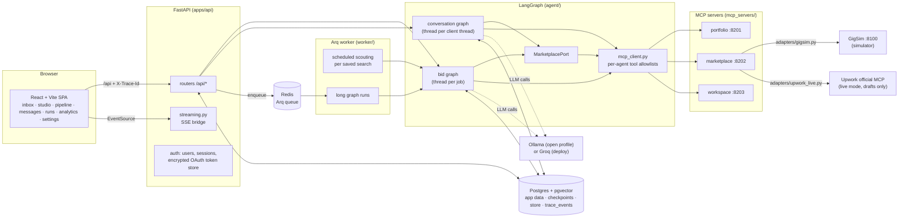
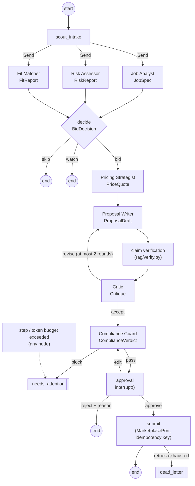
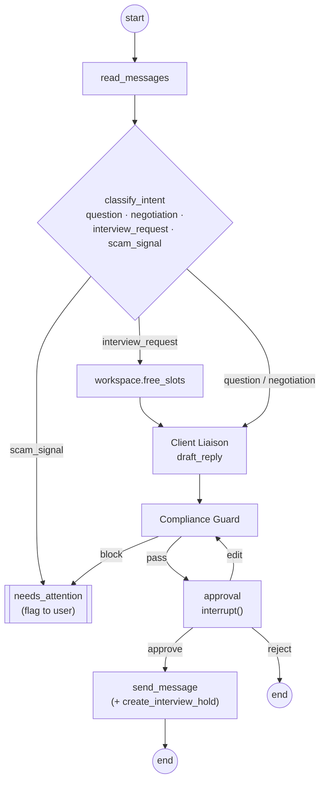
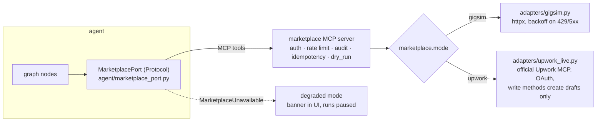
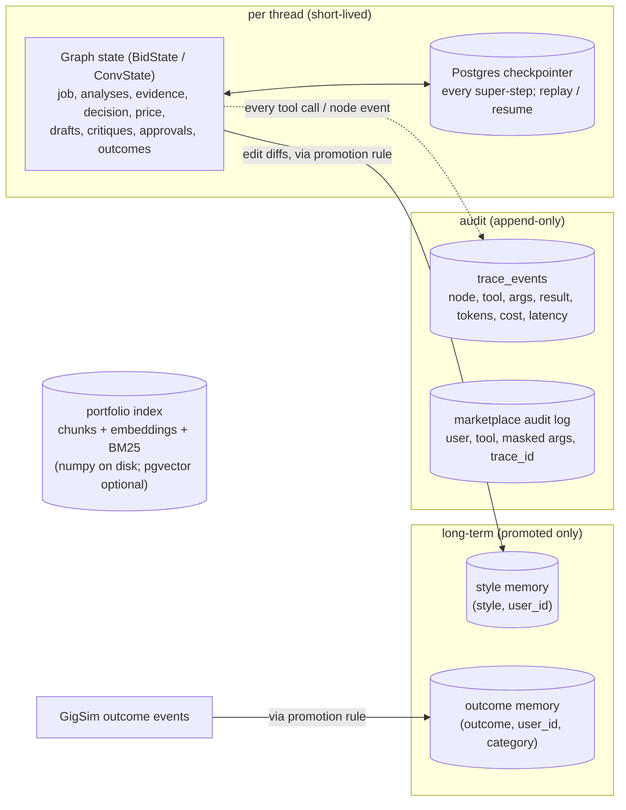

# GigBid architecture

GigBid finds freelance jobs worth bidding on, drafts proposals that only claim what the
portfolio can prove, and never sends anything without a human approving it. This page covers
the two LangGraph graphs, the marketplace port, the MCP surface and the stores, and explains why
each agent exists.

Measured results are not repeated here. They live in `evals/results/` and the README tables
generated from those files.

## 1. System overview

One trace id is created per UI request (or per scheduled scout), sent as `X-Trace-Id`, carried
in graph config, forwarded to every MCP call in `_meta.trace_id`, and written to both the
`trace_events` table and the marketplace audit log.

## 2. Bid graph (one thread per job)

- Analyst, Risk and Matcher run in parallel through `Send`; the state fields they write use
  reducers, so parallel writes merge instead of overwriting each other.
- The approval payload carries the draft, the evidence behind every claim, the risk report,
  the price rationale and the `dry_run` preview (cost in Connects, balance after).
- The submit idempotency key is `hash(thread_id, draft_version)`. A crash between approval and
  submit replays the node from the Postgres checkpoint with the same key, and the marketplace
  returns the original result instead of submitting twice.

## 3. Conversation graph (one thread per client conversation)

## 4. Marketplace port

Agents never call a marketplace directly. Switching from GigSim to live mode is a config change
(`MARKETPLACE_MODE=upwork`) that swaps the adapter behind the same MCP tools. The graphs, the
prompts and the UI do not change.

## 5. MCP surface

| Server | Tools | Resources / prompts | Notes |
|---|---|---|---|
| portfolio (:8201) | `search_evidence`, `get_case_study`, `list_skills` | `portfolio://case/{id}`, `portfolio://proposal/{id}`, `portfolio://repo/{id}`; prompt templates | Read-only. Published on its own (see `mcp_servers/portfolio/README.md`). |
| marketplace (:8202) | read: `search_jobs`, `get_job`, `get_client_history`, `get_connects_balance`, `list_threads`, `list_messages`, `get_market_stats`, `list_proposals`; write: `create_proposal_draft`, `submit_proposal`, `send_message` | none | Bearer auth, per-user token bucket set below GigSim's limit, append-only audit log, mandatory `idempotency_key`, `dry_run`, tool annotations. |
| workspace (:8203) | `free_slots`, `create_interview_hold`, `create_email_draft` | none | Local mock calendar and mailbox. |

Each agent gets only the tools it needs (`TOOL_ALLOWLIST` in `agent/mcp_client.py`). For
example, the Scout cannot submit, and only the submit and send nodes can reach write tools,
and only after an approval resume. The tool-by-tool trust rationale is in `docs/TOOLS.md`.

## 6. Stores: state, trace and memory kept apart

| Kind | What it holds | Where |
|---|---|---|
| State | What this job or conversation needs right now | `agent/state.py`, checkpointed in Postgres (SQLite locally) |
| Execution trace | Every tool name, argument, result and observation, plus tokens, cost and latency per node, with PII masked | `trace_events` table, LangSmith when `LANGSMITH_API_KEY` is set, marketplace audit log |
| Long-term memory | Only promoted knowledge: style rules learned from repeated edits, and what won or got replies per category | LangGraph store namespaces `("style", user)` and `("outcome", user, category)`. Rules are in `agent/memory/promotion_rules.py` and thresholds in `agent/config.yaml`. |

Raw tool output never goes straight into memory. The user can see and delete every memory item in
Settings.

## 7. Why each agent exists

| Agent | Hand-off | Why it is a separate agent |
|---|---|---|
| Scout | job ids into a bid thread | Runs on a schedule in the worker. It filters by saved searches and drops duplicates, so the expensive graph only sees new, on-profile jobs. It needs read-only search tools and nothing else. |
| Job Analyst | `JobSpec` | Breaks a messy post into explicit requirements, deliverables and screening questions. Retrieval and pricing need structured requirements, not prose. |
| Risk Assessor | `RiskReport` | Scams, off-platform contact and planted injections have to be caught before any text reaches the writer. It runs in parallel and can veto the job on its own. |
| Fit Matcher | `FitReport` | Maps each requirement to portfolio evidence (requirement-to-evidence matrix). This is the only source of claims the writer is allowed to make. |
| Decide | `BidDecision` | A deterministic or cheap-model join over the three reports, so skip, watch or bid can be explained and audited. Thresholds are in config. |
| Pricing Strategist | `PriceQuote` | Uses market stats, the client's history and the freelancer's floor and target. Kept separate so the price can be explained and tuned without touching the writer. |
| Proposal Writer | `ProposalDraft` | Drafts from the `FitReport` evidence and the style memory only. |
| Claim verification | claims with support labels | Splits the draft into claims and grounds each one. Unsupported claims are removed or rewritten before the Critic sees the draft. |
| Critic | `Critique` | Checks quality (generic openings, answers to screening questions, length). Bounded at two revision rounds. |
| Compliance Guard | `ComplianceVerdict` | Applies the policy pack (`data/policy_pack/`) as rules plus checks. It can block with a reason shown in the UI, and it re-checks human edits. |
| Client Liaison | reply drafts | Runs in the conversation graph. It classifies intent, drafts replies and offers interview slots, and every send goes through approval. |

Whether this split is worth its cost compared with a single ReAct agent and a prebuilt supervisor
is measured, not assumed (R&D question C). See the comparison table in the README and its source
file in `evals/results/`.

## 8. Failure handling

- Per-node retries and timeouts (`agent/config.yaml`). Cheap nodes have a fallback model, and every node
  has a deterministic heuristic path (`LLM_PROVIDER=heuristic`), which CI uses.
- GigSim 429 responses: the adapter honours `Retry-After` with backoff, and the MCP token bucket stays
  under the simulator's limit. 5xx responses are retried with backoff, then the run goes to `dead_letter`.
- If the marketplace MCP server is unreachable, `MarketplaceUnavailable` is raised, `/api/health` reports
  degraded and the UI shows the degraded banner. Pending approvals stay in the checkpointer until it returns.
- Exceeding the step or token budget moves the thread to `needs_attention`, which is visible in the inbox.

## 9. Deployment topologies

- **Local / compose**: one container per service (see `infra/docker-compose.yml`), with Postgres
  (pgvector), Redis, Arq worker and Ollama.
- **Public deploy (single host)**: the API process mounts GigSim at `/gigsim` and the MCP servers at
  `/mcp/*` (`MOUNT_GIGSIM=1`, `MOUNT_MCP=1`) and uses Groq for models. See ADR 0006 and
  `docs/RUNBOOK.md`.
